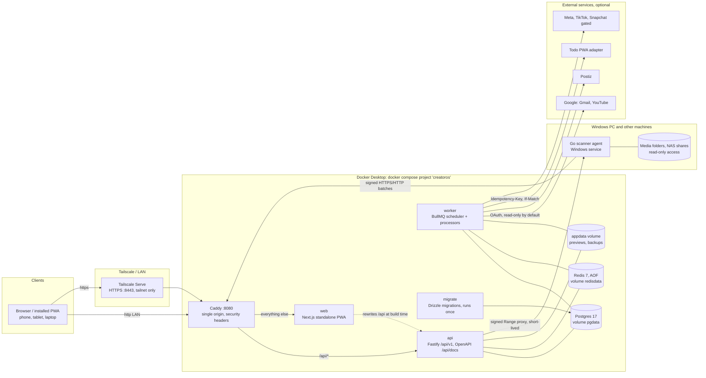

# Creator OS: architecture

Creator OS is a private, self-hosted web app for one creator (or a very small team). It runs on one Windows PC with Docker
Desktop, reachable on the LAN over HTTP and on your Tailscale network over HTTPS. Nothing is exposed to the public internet.

## System diagram

Postgres and Redis are never published to the network. The `dev` compose profile adds `db-proxy` and `redis-proxy`, which bind
to `127.0.0.1` only and exist for `pnpm dev`.

## Components

| Component             | Path                                  | Responsibility                                                                                                                                                                                           |
| --------------------- | ------------------------------------- | -------------------------------------------------------------------------------------------------------------------------------------------------------------------------------------------------------- |
| `packages/domain`     | pure TypeScript                       | Money (integer minor units), paths (Windows/POSIX canonicalisation), time zones and DST, action scoring, Gmail classification, checklist/stage rules, Zod schemas shared by API and agent                |
| `packages/db`         | Drizzle schema + SQL migrations       | 77 tables, partial unique indexes, `pg_trgm`, migration runner                                                                                                                                           |
| `packages/connectors` | provider clients                      | Google OAuth (PKCE), Gmail, YouTube, Todo adapter, Postiz/Meta/TikTok/Snapchat gates. Injectable `fetch`, `now`, `sleep`. Retry/backoff only for idempotent calls. Honest `NOT_CONFIGURED` states        |
| `packages/services`   | business logic                        | One module per area (ingest, library, assets, publishing, crm, actions, todo, integrations, insights, ops, auth, demo, ...). Every function takes a `Ctx {db, env, orgId, userId, actor, now}`           |
| `apps/api`            | Fastify                               | REST under `/api/v1` with a `{data, meta, error}` envelope, Zod validation, sessions + TOTP, CSRF, roles, idempotency keys, rate limits, signed agent endpoints, media streaming proxy, OpenAPI          |
| `apps/worker`         | BullMQ                                | Scheduler (heartbeat, events, action engine, provider sync, maintenance, nightly backup, weekly restore test), on-demand sync/backup requests. All jobs are idempotent so at-least-once delivery is safe |
| `apps/web`            | Next.js 16 App Router                 | The PWA: 13 sections, command palette, quick add, service worker with offline page, light/dark themes, 360px-first layout                                                                                |
| `apps/scanner-agent`  | Go                                    | Scans configured roots, settles/hashes/probes files, spools observations to disk, streams Range requests to the API, runs as a Windows service or systemd unit                                           |
| `infra`               | Compose, Caddy, Dockerfile, scripts   | Multi-stage Dockerfile (`migrate`, `api`, `worker`, `web` targets), backup/restore, diagnostics, restart test, Tailscale helper                                                                          |
| `tests`               | Vitest, Playwright, fixture generator | Integration tests on real Postgres, real Go agent tests, browser E2E                                                                                                                                     |

## Key flows

### File to library

1. The agent walks each root. A file that changed in the last `settleSeconds` is reported `STILL_WRITING` and is not hashed.
2. Stable files are hashed (SHA-256) and probed (ffprobe; images fall back to the Go standard library). Results are spooled to disk
   first, so a network outage never loses observations.
3. Batches (`/agents/ingest`) are signed with `HMAC(signingKey, timestamp + "." + sha256(body))`. Every observation has an
   `eventId`, so replays are no-ops.
4. The API creates or updates `file_instances`. Identical full hashes share one `media_objects` row. A quick signature alone
   never asserts "exact duplicate".
5. Missing detection only runs after a complete, non-suspicious scan, needs a second complete scan plus a grace period, and an
   unreachable root or offline device never produces "missing".

### Publishing

A `logical_asset` has `asset_versions`; a version has file copies. A `distribution_variant` is a publishable shape of an asset (a reel, a short). A
`publication_record` is one variant on one `social_account`. States run from `PLANNED` to `PUBLISHED_MANUAL` (typed by the
owner) or `PUBLISHED_VERIFIED` (a platform connection confirmed it). Nothing is ever posted automatically. A record can fulfil one
`deal_deliverable`; each deliverable keeps its own approval status.

### Todo sync

`internal_actions` are the local to-do list. When the owner sends one to Todo, a `task_links` row is created with the idempotency
key `creatoros:<orgId>:<actionId>`. The worker pushes it; Todo owns due date and completion (policy `TODO_OWNS_DUE_AND_COMPLETION`). A remote
edit made at the same time becomes a visible `CONFLICT`; a permanently failing remote ends as `DEAD_LETTER` after 8 attempts. Offline
shows `PENDING`, never "synced". See [TODO_ADAPTER.md](TODO_ADAPTER_CONTRACT.md).

## Counting rules

Counts are never produced by joining `file_instances x publication_records x deliverables`. `COUNT_DEFINITIONS` in
`packages/domain` defines each number and the SQL counts each entity separately, so one video published four times is
1 asset and 4 publications (test T14/T35).

## Entity relationship diagram

All 77 tables carry `org_id` (single-organisation product, enforced everywhere). The diagram shows the business core; support
tables (sessions, audit, settings, outbox, idempotency keys, background jobs, notifications, webhooks) hang off `organizations`/`users`.

```mermaid
erDiagram
  organizations ||--o{ organization_memberships : has
  users ||--o{ organization_memberships : joins
  users ||--o{ sessions : signs_in

  brands ||--o{ channels : has
  channels ||--o{ social_accounts : has
  provider_connections ||--o{ social_accounts : authorises
  provider_connections ||--o{ sync_cursors : tracks
  provider_connections ||--o| task_integrations : configures

  brands ||--o{ content_series : groups
  ideas }o--|| brands : for
  ideas |o--o| creative_projects : becomes
  content_series ||--o{ creative_projects : contains
  creative_projects ||--o{ production_scenes : plans
  creative_projects ||--o{ project_checklist_items : tracks
  project_checklist_templates ||--o{ project_checklist_items : seeds
  creative_projects ||--o{ project_status_events : logs
  creative_projects ||--o{ songs : produces
  production_scenes }o--o| asset_versions : selected_final

  devices ||--o{ storage_roots : holds
  devices ||--o{ device_credentials : authenticates
  storage_roots ||--o{ file_instances : contains
  storage_roots ||--o{ scan_runs : scanned_by
  storage_roots ||--o{ scan_observations : reports
  media_objects ||--o{ file_instances : identifies
  file_instances ||--o{ derived_previews : previews
  media_objects ||--o{ duplicate_candidates : may_match

  logical_assets ||--o{ asset_versions : versions
  media_objects |o--o{ asset_versions : content_of
  asset_versions ||--o{ asset_file_links : located_at
  file_instances ||--o{ asset_file_links : linked
  logical_assets ||--o{ asset_match_suggestions : suggested

  logical_assets ||--o{ distribution_variants : shaped_as
  distribution_variants ||--o{ publication_targets : planned_for
  social_accounts ||--o{ publication_targets : receives
  distribution_variants ||--o{ publication_records : published_as
  social_accounts ||--o{ publication_records : posted_on
  asset_versions |o--o{ publication_records : uses
  publication_records ||--o{ publication_status_events : history
  publication_records ||--o{ publication_metrics_snapshots : measured_by
  publication_records ||--o{ publishing_schedules : scheduled_by

  external_organizations ||--o{ contacts : employs
  external_organizations ||--o{ opportunities : offers
  contacts ||--o{ conversation_threads : writes
  provider_connections ||--o{ conversation_threads : syncs
  conversation_threads ||--o{ messages : holds
  messages ||--o{ inbound_classifications : classified_as
  opportunities |o--o| deals : converts_to
  conversation_threads }o--o| deals : about
  deals ||--o{ deal_deliverables : requires
  deals ||--o{ deal_contracts : governed_by
  deals ||--o{ invoices : billed_by
  invoices ||--o{ payments : paid_by
  deals ||--o{ expenses : costs
  deal_deliverables |o--o| publication_records : fulfilled_by
  deal_deliverables |o--o| asset_versions : delivers

  internal_actions ||--o{ task_links : synced_as
  task_integrations ||--o{ task_links : owns
  goals ||--o{ goal_observations : measured_by
```

## Security model

- One owner is created on first run through the setup wizard. There is no default password. Passwords need a strong passphrase;
  TOTP is optional and enforced once enabled. Sessions are server-side, revocable, and idle-expire.
- Roles are `VIEWER < EDITOR < OWNER`. Viewers see creative planning, publishing and analytics, never CRM, e-mail, finance, files,
  devices, integrations or tokens (including in search). Owner-only: members, audit, backups, pairing codes.
- Browser requests need a same-origin `Origin`; scripts must send `X-Requested-With`. Agent requests are bearer-token plus HMAC signed with a timestamp.
- Provider credentials and TOTP secrets are encrypted with `ENCRYPTION_KEY` (AES-GCM) and never returned by any endpoint.
- The agent opens files read-only and refuses any stream request outside a configured root (symlinks included). Streaming URLs are
  short-lived and HMAC-signed. Originals are never moved, renamed, or deleted.
- Nothing is sent, posted, or deleted without an explicit owner action. E-mail connections request read-only scopes unless the
  owner explicitly asks for drafts.
